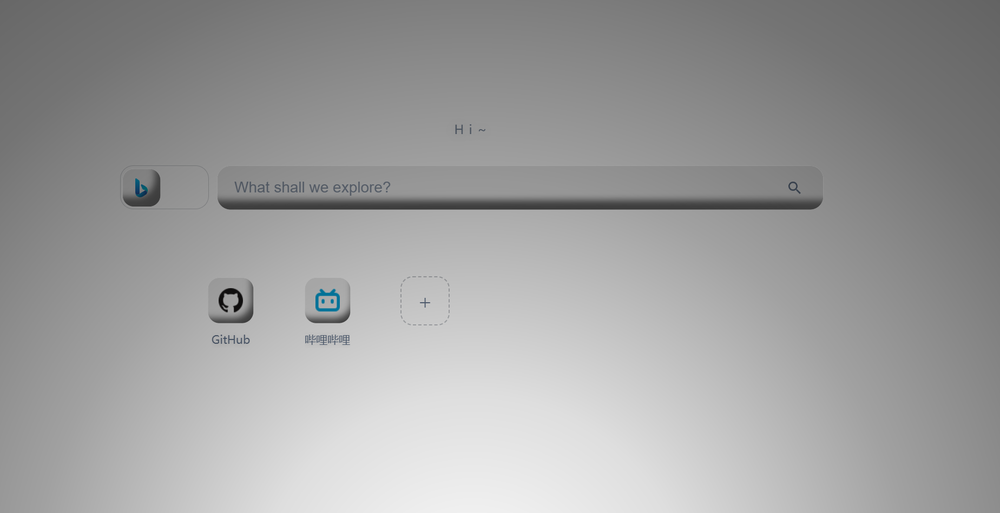

# Explorer Home Page

一个 **Edge 浏览器主页扩展**

## 功能一览

| 功能 | 说明 |
| --- | --- |
| 📶 网络角标 | **实时显示**网络连通情况和延迟 |
| 🔍 切换搜索引擎 | 可切换 必应 / Google **两个搜索引擎** |
| 🧭 快捷方式 | 自由增删改、**拖拽排序**常用网站 |
| ⚙️ 设置页 | 配色、光影、签名、数据**全部可自定义**，修改立即生效 |
| ✨ 页面效果 | 随指针移动的**双层光影**，指针离开窗口时光影停在最后的位置 |
| 💾 数据本地化 | 全部数据均保存在**本地**，支持一键导出/导入 JSON 备份 |

## v2.0.3 源码更新

- 搜索下拉列表支持单条删除历史。历史候选用线框时钟标识，鼠标悬停时显示垃圾桶按钮。

## v2.0.2 更新

- 复用光斑和阴影图层，减少鼠标移动时重复计算投影，保留原有双层光影。
- 修复窄窗和竖屏上设置内容从其他孔洞露出的问题。跨屏时，开合中的设置面板会跟随新窗口尺寸。
- 导入备份前先校验结构，避免空 JSON 对象或缺少必要字段的备份覆盖本地数据。

## 安装

1. 打开 [最新发布](https://github.com/CaulCaul/ExplorerHomePage/releases/latest)，在 **Assets** 中下载 `explorer-homepage-v*.zip`，解压到一个固定目录。
2. 在 Edge 地址栏输入 `edge://extensions`，开启「开发人员模式」。
3. 点击「加载解压缩的扩展」，选择直接包含 `manifest.json` 的目录。
4. 按 `Ctrl+T` 打开新标签页。

> ⚠️ 如果之前安装过其他「新标签页/主页」类扩展（Infinity、Tabliss 等），它们会互相抢占新标签页，请在扩展页把其他同类扩展禁用。

## 界面与设置

点击右上角齿轮展开设置，再点齿轮、点击面板外侧或按 Esc 收起。拖动窗口到另一块屏幕时，主页按浏览器内容区的实际大小调整布局，设置面板随自己的孔洞开合。

### 搜索历史

从 v2.0.3 起，把鼠标移到带时钟图标的历史候选上，点击右侧出现的垃圾桶即可删除这条记录。要清除所有搜索历史，打开齿轮里的「数据」，点击「清空历史」并再点一次确认。

## 数据安全

你的**搜索历史、快捷方式、引擎偏好**保存在 Edge 浏览器的**扩展本地存储**（`chrome.storage.local`）中：

- 与仓库文件无关——删除/重新克隆仓库不会丢数据；
- 从**同一个路径**重新加载扩展，数据保持连续；
- ⚠️ Edge「清除浏览数据 → Cookie 和其他站点数据」会清空这些数据，清理前请先导出；
- ⚠️ 卸载扩展会清空这些数据。

## 备份与恢复

1. 打开新标签页，点击右上角齿轮，在「数据」区点击「导出数据」。下载的 JSON 文件包含快捷方式、搜索历史、当前搜索引擎和外观设置。
2. 恢复时，在同一区域点击「导入数据」，再点一次确认，然后选择备份文件。通过结构校验后，备份会覆盖对应的本地数据。

## 更新

从 [Releases](https://github.com/CaulCaul/ExplorerHomePage/releases) 下载新版本的扩展 ZIP。将解压出的文件复制到**原安装目录**并覆盖同名文件，再到 `edge://extensions` 点击「Explorer Home Page」卡片上的「重新加载」。保留原安装路径可延续本地数据。在新标签页的「设置 → 关于」查看版本。
